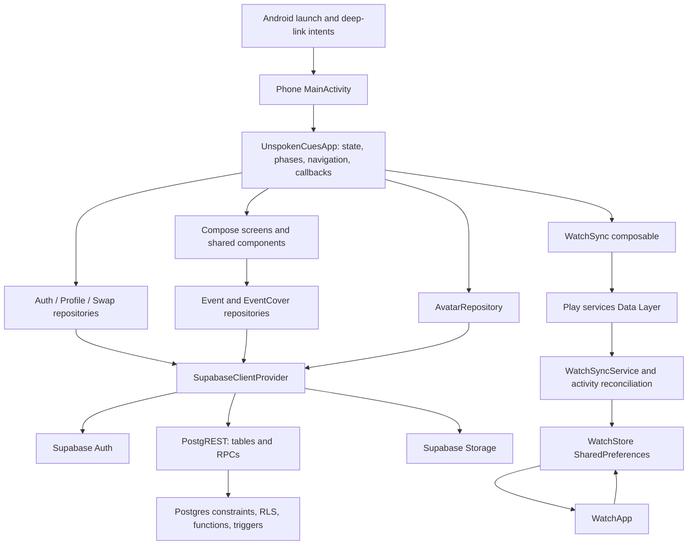

# Architecture and state ownership

Return to the [handoff index](README.md). Source entry point: [MainActivity.kt](../../app/src/main/java/com/example/unspokenqueues/MainActivity.kt).

## System boundaries

This is a Kotlin/Jetpack Compose application with thin repositories and root-owned state. It does **not** currently use ViewModels, a dependency injection framework, Navigation Compose, Room, WorkManager, a custom HTTP server or Supabase Realtime subscriptions. Do not assume those layers exist when tracing a bug. Each project contains one Android application module; the shared watch contract is duplicated in source rather than supplied by a shared library.

## Layers and dependencies

| Layer | Responsibility | Dependency direction |
| --- | --- | --- |
| `MainActivity` | Android intent lifecycle, stored theme, edge-to-edge system bars | Creates root composition |
| `UnspokenCuesApp` | Session collection, account loading, application phases, tab/overlay selection, watch snapshot, most profile/swap callbacks | Calls repositories and renders screens |
| `ui/screens` | Forms, display, screen-level state and user feedback | Receives callbacks; event screens call injected repositories |
| `ui/components` | Cards, photos, QR generation/scanner, event rows, common controls | Models, Android/Compose APIs, Coil, CameraX, ML Kit, ZXing |
| `model` | Domain objects and rules: cues, phases, schedules, visibility, filters, card links, companion snapshot | Mostly Kotlin; `Models.kt` also references Compose colors |
| `data` | DTO mapping and Supabase/Auth/Storage operations; image processing; watch publishing | Domain models and external SDKs |
| SQL | Persistence, authorization, mutual swaps, event membership/counting, signup automation | Supabase Auth/Postgres/Storage |

Repositories create their SDK dependency lazily, using the singleton unless given an optional client. `EventRepository` and `EventCoverRepository` are open for fake implementations in UI tests. Auth and upload screens also accept suspending callbacks, so isolated tests do not require real accounts.

## Startup and account lifecycle

`MainActivity.onCreate` reads an initial intent only for a fresh creation. `onNewIntent` handles links arriving while the singleTop activity exists. It persists `ThemeMode` in `settings`, calculates light/dark appearance and renders `UnspokenCuesApp`.

The root collects `AuthRepository.sessionStatus`. Authenticated confirms the current account and allows profile loading. NotAuthenticated clears the account identifiers and onboarding decision. Transient Auth initialization is deliberately ignored so opening the camera or resuming does not flash a signed-out screen. `sessionUserId` is not restored across recreation: it prevents a database read before the SDK confirms the session.

`appPhase` selects SIGNED_OUT, LOADING, PROFILE_SETUP, TUTORIAL or MAIN. Password recovery is an additional root-level override because a valid recovery session is authenticated but must show password entry first. See [feature flows](feature-flows.md).

An account change clears token, binder, open event and overlay state in the authenticated branch. Watch publishing additionally waits until the loaded profile belongs to the confirmed session. Initial profile state still uses `MockData.profile`; this is a placeholder in a real-backed application, not an offline account cache. See the account-load risk in [known issues](known-issues.md).

## Navigation

`Tab` defines Cue, Events, QR, Binder and Profile in that order. Enum/boolean state, `AnimatedContent` and early composition returns select what is shown. `Overlay` priority is Edit Profile → Settings → Create Event → Event Detail → tabs. `BackHandler` dismisses the active overlay; auth, tutorial, recovery, scanner and watch screens add their own handlers.

`EventSaver` converts an open event to a list of primitives for restoration, including epoch timestamps and comma-joined tags. Changing `Event` requires reviewing this saver, DTOs, SQL and tests. Normalized tags contain no commas, which makes the current encoding viable for app-created events. `lastOpenEvent` preserves content during the outgoing animation after the selected event is cleared.

There are no web routes for profiles or events. Card links and password recovery use separate custom-scheme intent filters. Event QR codes contain the raw join code and are interpreted inside the Events scanner, not as an Android deep link.

## Persistence and freshness

| State | Owner/storage | Restore/refresh behavior |
| --- | --- | --- |
| Auth session | Supabase Auth plugin | Persisted and automatically refreshed by SDK |
| Profile, cue, onboarding flag | `profiles` | Loaded after confirmed session, or explicit load retry |
| Root UI cue/tab/overlays, some form fields and open event | `rememberSaveable` | Android saved state; not a durable general cache |
| Profile object, binder cards, most results/errors | `remember` | Lost on composition/process recreation; fetched again where effects exist |
| Theme and `onboarded_<uid>` | Phone `settings` SharedPreferences | Theme device-wide; onboarding per account |
| `watch_owner` | Phone `settings` | Last account whose active DataItem was successfully submitted locally |
| Watch publisher fields, revision and generation | Phone `watch_publisher` preferences | Reused across app restarts; explicitly excluded from backup/transfer |
| Memberships, events, swaps, card tokens | Supabase tables | Explicit repository queries; no live subscriptions |
| Uploaded JPEGs | Public Storage buckets | URL stored in profile/event; image loading uses Coil |
| Watch cue/profile/lock/order metadata | Watch `watch_state` preferences | Survives restarts/disconnection; backups excluded |

Binder loads on sign-in while Cue or Binder is selected, and whenever switching into either tab. A failed load leaves the previous in-memory value. Card token loads on sign-in and retries on tab changes until non-null. Events load when their screen enters composition; attendee refresh is explicit. Event time classification uses a remembered `Instant`, not a continuously ticking clock.

## Writes, errors and concurrency

Calls run in Compose coroutine scopes/effects; repository methods generally throw. Image decoding/compression explicitly runs on `Dispatchers.IO`. SDK calls are suspending. Structured cancellation is rethrown in many form/event paths; several root callbacks instead use `runCatching` and discard errors.

Cue selection, profile visibility and profile edits update local state immediately. Their server writes have no user-visible failure/rollback and no durable retry queue. Profile image uploads complete before `onSave`, but the profile and card-image database updates then run as separate best-effort calls. Binder removal is optimistic and restores the captured list if deletion throws. Event create/join/RSVP/end/delete/leave expose errors and gate most duplicate work. Watch publishing has its own repeated delivery attempt; this does not retry failed database writes.

These differences matter when a UI looks successful but a relaunch restores an older server value. There is no general cross-device conflict resolution or optimistic version field for profiles. For reliable future changes, define when a save is acknowledged, whether local data rolls back, and how errors/retries are presented.

## Presentation system

`Color.kt` defines neutral paper/ink palettes and fixed cue colors, mirrored by the watch enum. `Theme.kt` disables dynamic system colors to preserve cue meanings. `Type.kt` uses bundled Bricolage Grotesque and Figtree variable fonts; licenses live in `app/licenses`. Motion constants are 150/250/400 ms with decelerating curves. `rememberReduceMotion` suppresses looping pulses when animations are disabled. `Ambience.kt` paints the current cue wash beneath tabs. Keep text/meaning alongside colors; the watch also uses distinct symbols and a cue guide.
