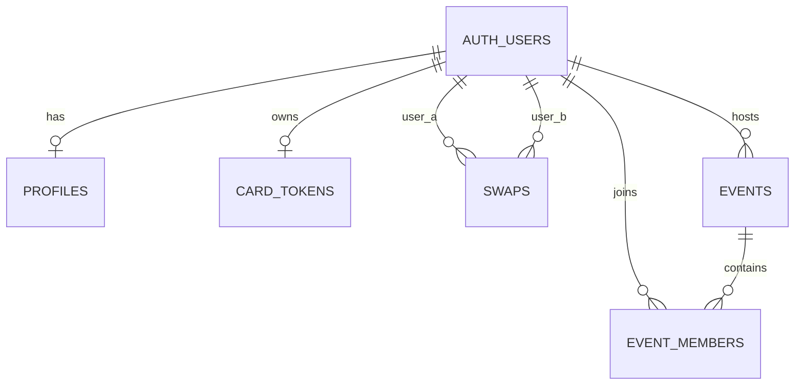

# Database, storage and authorization

Return to the [handoff index](README.md). The authoritative local definition is [supabase/schema.sql](../../supabase/schema.sql). No live database was queried for this handoff.

## Relationships



Foreign keys reference `auth.users`; deleting an Auth user cascades profiles, tokens, swaps, hosted events and memberships. Deleting an event cascades its memberships. Storage objects are not covered by these public-table cascades. There is no account-deletion flow in the app.

## Data dictionary

| Object | Fields and defaults | Constraints/indexes |
| --- | --- | --- |
| `public.cue_status` | GREEN, YELLOW, RED, PURPLE | Postgres enum; exact spelling is shared with both apps |
| `profiles` | id UUID; display_name/bio empty text; preferences/boundaries empty text arrays; is_public=true; status=GREEN; created_at/updated_at=now; avatar_url/card_image_url empty text; onboarding_complete=false | id PK/FK to Auth; update timestamp trigger |
| `swaps` | user_a/user_b UUID; created_at=now | Composite PK; check user_a < user_b; both Auth FKs; index user_b |
| `card_tokens` | user_id UUID; token text default UUID without hyphens; created_at=now | user_id PK/FK; token unique |
| `events` | id random UUID; host_id default auth.uid(); required name/join_code; details empty; active=true; created_at=now; starts_at/ends_at nullable timestamptz; location/cover_url/host_name empty; tags empty text array; is_public=false; going_count=0 | id PK; join_code unique; host Auth FK; host_id, starts_at indexes; partial is_public index |
| `event_members` | event_id/user_id UUID; joined_at=now; rsvp='going' | Composite PK/FKs; rsvp check in ('going','maybe'); user_id index |

There is no schema constraint requiring an event name to be nonblank, end to follow start, tags to have the UI's length/count, or a join code to match the UI alphabet. There is no expiry/rotation column for card tokens. Profile preference/boundary and bio requirements are UI rules. Preserve these distinctions when adding another client.

## Functions and triggers

| Function | Caller/trigger | Behavior |
| --- | --- | --- |
| `set_updated_at()` | BEFORE UPDATE on profiles via `trg_profiles_updated_at` | Replaces updated_at with now |
| `handle_new_user()` | AFTER INSERT on auth.users via `on_auth_user_created` | Inserts id and display_name from raw metadata; conflict is a no-op |
| `is_event_member(p_event_id uuid)` | Event/membership RLS | Stable SECURITY DEFINER lookup of caller's membership; avoids policy recursion |
| `join_event_by_code(code text)` | Authenticated RPC | Requires auth.uid; finds trimmed case-insensitive active code; inserts caller membership if absent; returns event |
| `my_card_token()` | Authenticated RPC | Requires auth.uid; creates caller token if absent, returns stable token |
| `swap_by_card_token(card_token text)` | Authenticated RPC | Requires auth.uid; normalizes token; resolves owner/profile; rejects self; inserts ordered mutual pair if absent; returns owner profile |
| `refresh_going_count()` | AFTER INSERT, UPDATE OF rsvp or DELETE on event_members via `event_members_going_count` | Recounts Going members for the affected event and updates going_count |

Signup, membership helper, RPCs and count function use SECURITY DEFINER with `search_path = public`. The three application RPCs revoke execute from public/anon and grant authenticated. Their privilege boundary is part of the API; review them as server code, not convenience wrappers. The helper and trigger functions have no equivalent explicit execute revocations in this script.

RPC SQLSTATEs: `28000` unauthenticated; `P0002` event/token/profile not found; `22023` own card. Unique violation `23505` drives event-code insert retries in the phone.

`join_event_by_code` checks active but not schedule. Its conflict no-op preserves an existing RSVP. The event row is selected before membership insertion, so the RPC's returned going_count may lag the count trigger. The count trigger only responds to membership changes; applying the schema does not recompute counts for all old events.

## RLS access matrix

These are the policies in the script, subject to the environment's table grants and any extra policies. Policies combine permissively; a client-side filter does not narrow another permitted server read.

| Table | SELECT | INSERT | UPDATE | DELETE |
| --- | --- | --- | --- | --- |
| profiles | Owner, any public row, or a swap partner's row | Own id | Own row/id | Own row |
| swaps | Either participant | No direct policy; RPC inserts | No policy | Either participant |
| card_tokens | Owner only | No direct policy; RPC creates | No policy | No policy |
| events | Host, member, or authenticated reader of a public event | Own host_id | Host | Host |
| event_members | Co-member or event host | Authenticated caller as own user_id | Authenticated caller's own membership | Own membership |

The public-profile read policy has no `TO authenticated` restriction; it is public subject to grants. Existing swap partners retain private-profile access. Event membership does **not** itself grant profile-row access. Consequently a host may read all membership IDs but only some profiles. `visibleAttendees` hides Red/Purple from ordinary viewers in UI only; SQL does not implement cue-dependent profile visibility.

Direct membership INSERT checks only user_id, plus normal FK constraints. It does not require proof of code possession, public visibility, host approval, active status or a valid schedule. Do not treat a hidden code or UI-disabled RSVP button as a server access rule. See [known issues](known-issues.md).

`swap_by_card_token` deliberately bypasses ordinary row reads. It does not require owner is_public=true; possession of a valid token remains sufficient for a new mutual connection. There is no explicit acceptance step on the owner's device.

## Storage

The schema creates two public buckets: `avatars` and `event-covers`; reapplying it sets `public=true` on existing matching buckets. For each bucket it adds SELECT for its objects and authenticated INSERT/UPDATE/DELETE only when the object's first folder equals `auth.uid()::text`. UPDATE checks both existing and resulting path. Clients choose paths under the signed-in UUID.

Avatar/card paths are overwritten; timestamp query strings invalidate image caches. Covers use new versioned filenames. Images are public independently of the row that references them. Clearing a row URL, deleting an event or setting a profile private does not revoke an already known image URL. No object retention/cleanup job, size quota configuration or server content validation is defined here.

## Schema change workflow

The file grows by numbered sections: base profiles/status; swaps; avatar; events/members/RLS/join; avatar storage; tokens/swapping; onboarding; extended events/RSVP/covers; card images. Run all sections for a fresh environment. `IF NOT EXISTS` does not repair incompatible existing column types/constraints. CREATE OR REPLACE and DROP/CREATE policy/trigger operations actively replace definitions.

For an existing environment: inspect differences and back up, validate the whole change on development data, define any backfill and rollback separately, apply in a coordinated release, then verify using actual client roles. A downgrade APK does not roll back SQL or restore deleted data. The repository has no migration ledger, down migrations or deployment automation.

## Verify an environment

Run these read-only inventory queries in the intended Supabase project and compare definitions with the checked-in SQL. The SQL editor normally uses elevated privileges, so these inventory results alone do not test RLS.

```sql
select table_name, column_name, data_type, column_default, is_nullable
from information_schema.columns
where table_schema = 'public'
  and table_name in ('profiles', 'swaps', 'card_tokens', 'events', 'event_members')
order by table_name, ordinal_position;

select tablename, rowsecurity
from pg_tables
where schemaname = 'public'
  and tablename in ('profiles', 'swaps', 'card_tokens', 'events', 'event_members');

select schemaname, tablename, policyname, roles, cmd, qual, with_check
from pg_policies
where (schemaname = 'public'
       and tablename in ('profiles', 'swaps', 'card_tokens', 'events', 'event_members'))
   or (schemaname = 'storage' and tablename = 'objects')
order by schemaname, tablename, policyname;

select id, public from storage.buckets
where id in ('avatars', 'event-covers');

select p.proname, p.prosecdef, p.proacl, pg_get_functiondef(p.oid)
from pg_proc p join pg_namespace n on n.oid = p.pronamespace
where n.nspname = 'public'
  and p.proname in ('set_updated_at', 'handle_new_user', 'is_event_member',
                   'join_event_by_code', 'my_card_token',
                   'swap_by_card_token', 'refresh_going_count');

select trigger_schema, event_object_table, trigger_name,
       event_manipulation, action_statement
from information_schema.triggers
where (event_object_schema = 'public'
       and event_object_table in ('profiles', 'event_members'))
   or (event_object_schema = 'auth' and event_object_table = 'users');
```

The script's older manual-test comments omit newer fields/policy totals. Use definitions above rather than those historical counts. Test with two ordinary accounts, private/public profiles and an unrelated viewer: own-row writes, other-row denials, token secrecy, mutual swap creation/removal, code joins, host-only event changes, public discovery and storage ownership. Expected-error SQL statements abort a transaction; run negative checks separately or under savepoints before continuing. Perform mutation tests only in a designated development environment and remove test data deliberately.
